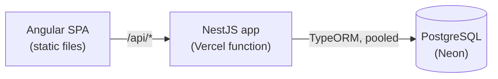

# Expense Flow

[](https://github.com/bjonimerkuri/expense-flow/actions/workflows/ci.yml)
[](https://github.com/bjonimerkuri/expense-flow/actions/workflows/codeql.yml)


Expense submission, approval and payment. Employees submit, managers approve or reject (with a reason), and finance
marks approved expenses as paid. Every change is written to an audit trail.

**[Live demo](https://expense-flow-azure-nu.vercel.app/login)** · demo accounts `employee@example.com`,
`manager@example.com`, `finance@example.com` (password `password123`; the sign-in page has one-click buttons).


## What is interesting here

- **Separation of duties.** The right role must perform each step, and nobody can act on their own expense, even a
  manager. The rules are pure functions with unit tests, and the API returns each expense's allowed `actions` so the UI
  never re-implements them.
- **Safe under concurrency.** Transitions run in a transaction with a row lock. Two reviewers acting at once cannot both
  win; an integration test fires both requests together.
- **Honest money.** Amounts are integer cents with a database `CHECK (amount > 0)`, and the UI rounds safely.
- **Audit trail.** Each status change records who did it, when, and why. The expense page shows the history.
- **Migrations, not `synchronize`.** Hand-written TypeORM migrations carry `CHECK` constraints, foreign keys and indexes,
  and run under an advisory lock in the deploy build.
- **Production-minded API.** Fail-fast env validation, `helmet`, request IDs with redacted structured logs, rate-limited
  auth, pinned JWT algorithm, timing-safe login, `forbidNonWhitelisted` validation (a client cannot self-assign a role),
  `/api/health`, OpenAPI document at `/api/openapi.json`.
- **Modern Angular.** Standalone components, signals, new control flow, lazy routes with a role guard, optimistic
  updates that roll back on failure (covered by an e2e test).
- **Accessible.** Labelled controls, skip link, live regions, visible focus, status as text plus colour, tabular figures
  for money, and axe checks in the e2e suite.

## Architecture



More in [docs/architecture.md](docs/architecture.md).

| Layer | Choices |
|---|---|
| Web | Angular 18, RxJS, TypeScript, self-hosted variable font |
| API | Node 20, NestJS 10, TypeORM, class-validator, JWT, bcrypt, pino, helmet, throttler, Swagger |
| Data | PostgreSQL 16 |
| Quality | Jest, Supertest, Playwright, axe, ESLint (with Angular a11y rules), Prettier, GitHub Actions, CodeQL, Dependabot |
| Hosting | Vercel (static + serverless function), Neon Postgres |

## Run it locally

Requires Node 20 and Docker.

```bash
docker compose up -d      # PostgreSQL, with expenses and expenses_test databases
npm ci
npm run db:migrate && npm run db:seed
npm run dev               # web http://localhost:4200, API http://localhost:3001/api, Swagger UI /api/docs
```

| Script | What it does |
|---|---|
| `npm run dev` | API and web app with reload |
| `npm run check` | Format check, lint, typecheck, unit tests, build |
| `npm test` / `npm run test:coverage` | Unit tests for the workflow rules and config |
| `npm run test:int` | API integration tests against PostgreSQL |
| `npm run e2e` | Playwright end-to-end tests (builds and starts both servers, resets the database) |
| `npm run db:migrate` / `db:seed` / `db:reset` | Schema, demo data, wipe and reseed (never in production) |

## Testing strategy

| Level | What it proves | Where |
|---|---|---|
| Unit | Status flow, roles, separation of duties, config validation | `apps/api/src/*.spec.ts` |
| Integration | Auth, visibility, full workflow over HTTP, concurrent reviewers, audit trail, summaries | `apps/api/test/` |
| End-to-end | Employee, manager and finance flows in a real browser, role access, rollback, accessibility | `e2e/tests/` |

CI runs three parallel jobs (quality, integration, e2e) against PostgreSQL service containers and uploads the Playwright
report on failure.

## API

Routes are under `/api` and, except auth and health, need `Authorization: Bearer <token>`. The full contract is the
OpenAPI document at `/api/openapi.json` (Swagger UI at `/api/docs` locally).

| Method | Route | Access |
|---|---|---|
| POST | `/auth/register`, `/auth/login` | public, rate limited |
| GET | `/expenses?status=&page=&pageSize=` | employees see their own; managers and finance see all |
| POST | `/expenses` | any user (amount in integer cents) |
| GET | `/expenses/:id` | bjonimerkuri or reviewer, with history; `404` otherwise |
| POST | `/expenses/:id/approve`, `/reject` | manager, not on their own expense |
| POST | `/expenses/:id/pay` | finance, approved expenses only |
| GET | `/expenses/summary` | manager, finance |
| GET | `/health` | public |


## License

[MIT](LICENSE)
