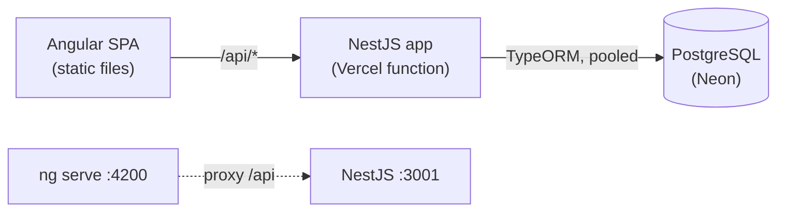
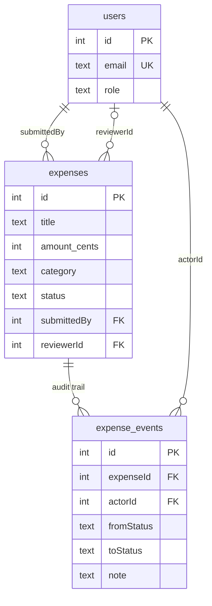
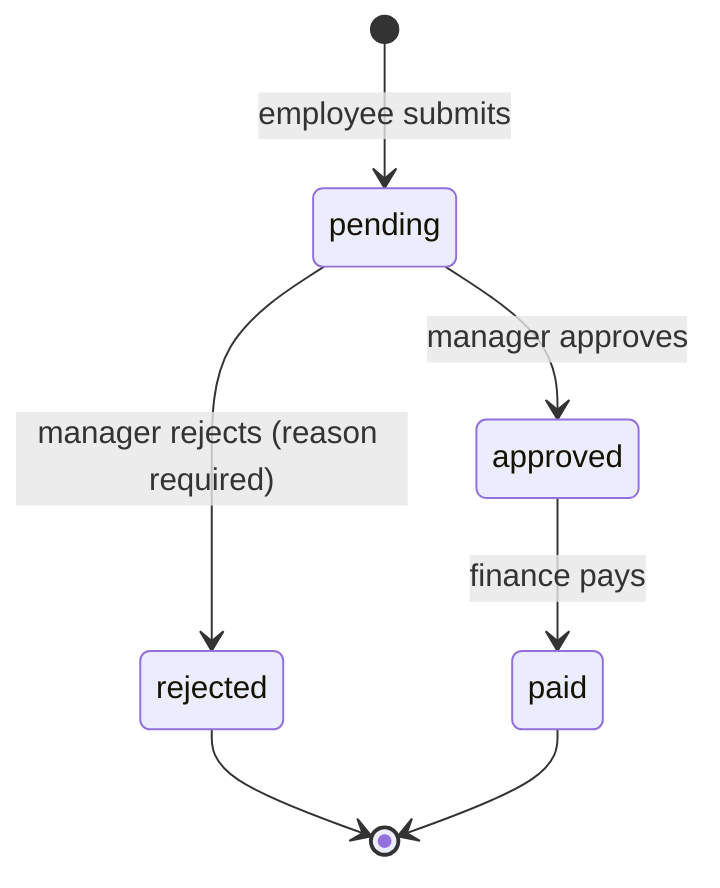

# Architecture

## Runtime

## Data model

## Status flow and who may move it

Nobody may act on an expense they submitted, whatever their role.

## Where things live

| Concern | Location |
|---|---|
| Rules (pure, unit-tested) | `apps/api/src/expenses/expense.rules.ts` |
| Transitions, locking, audit events | `apps/api/src/expenses/expenses.service.ts` |
| Config and fail-fast env validation | `apps/api/src/config.ts` |
| Schema | `apps/api/src/migrations`, wired in `data-source.ts` |
| App wiring shared by server, function and tests | `apps/api/src/configure-app.ts` |
| Vercel function entry | `api/index.js` → `apps/api/src/serverless.ts` |
| Angular features / core / shared | `apps/web/src/app/{features,core,shared}` |
| Tests | unit `apps/api/src/*.spec.ts`, integration `apps/api/test/`, e2e `e2e/tests/` |
